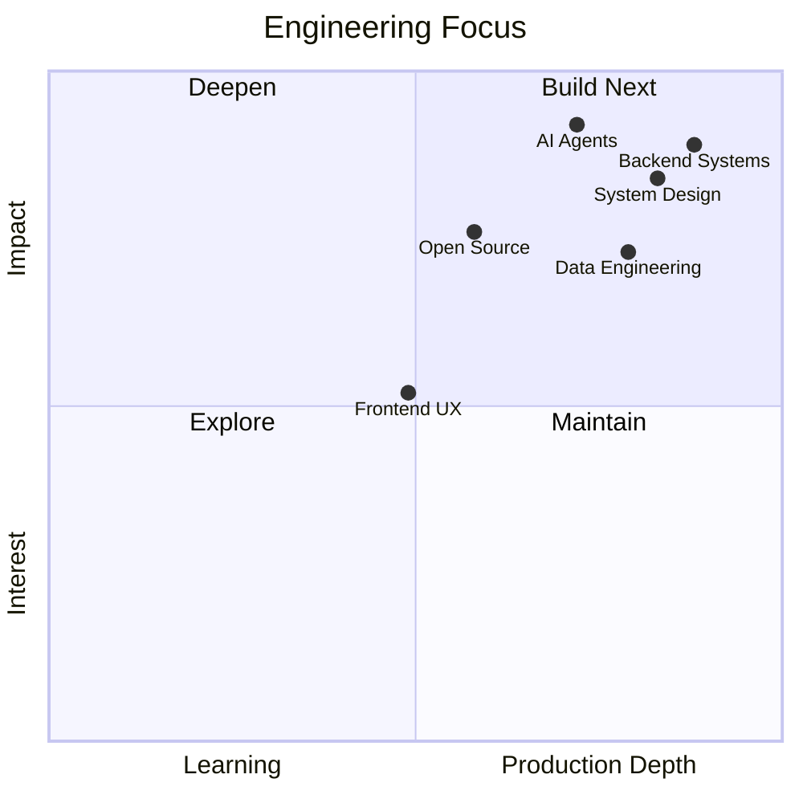

# Hi, I'm Suyash Jawadekar 👋

**Software Engineer focused on backend systems, AI-powered tools, and scalable web platforms.**

📍 Frisco, Texas  
🌐 [Portfolio](https://suyashjawadekar.vercel.app/)  
💼 [LinkedIn](https://www.linkedin.com/in/suyash-jawadekar/)  
📫 [Email](mailto:suyash048@gmail.com)

## About me

I'm a Software Engineer with experience building backend services, automation workflows, and AI-driven developer tooling. My recent work has focused on semantic search, debugging systems, distributed services, and data-heavy applications. [page:1]

I enjoy working across backend engineering, machine learning applications, and developer productivity tools. Lately, I’ve also been building projects that combine LLMs, embeddings, and search to make systems easier to debug and use. [page:1]

## Focus areas

> If the chart does not render well on GitHub, replace it with a PNG export.

## Experience highlights

### Amdocs — Sr. Software Engineer
- Built and supported large-scale telecom systems used in billing, provisioning, and validation workflows. [page:1]
- Engineered microservices and backend improvements for high-reliability environments. [page:1]
- Developed an AI-powered semantic search/debugging platform using embeddings, LangChain, and ChromaDB, reducing lookup time by 40%+. [page:1]
- Automated validation and data workflows with Python, SQL, and CI/CD tooling, cutting feedback cycles significantly. [page:1]

## Featured projects

### ReviewRecommender
AI-powered review search system using embeddings, vector search, and NLP to find relevant Yelp reviews by intent and sentiment. [page:1]

### SpeechNet
Deep learning audio classification pipeline for speech vs noise detection, built with scalable preprocessing and model training workflows. [page:1]

## Tech stack

**Languages:** Python, Java, JavaScript, SQL  
**Backend:** Spring Boot, FastAPI, Microservices  
**AI/ML:** LangChain, OpenAI Embeddings, ChromaDB, PyTorch, Pandas  
**Cloud/Tools:** AWS, Docker, Jenkins, Git

## Education

- **Stevens Institute of Technology** — MS in Information Systems, GPA 3.86 [page:1]
- **K.J. Somaiya College of Engineering** — B.Tech in Computer Science [page:1]

## GitHub stats

## Connect

I’m interested in backend engineering, AI/ML products, and scalable developer tools. I’m always happy to connect with engineers, builders, and teams working on interesting systems.
